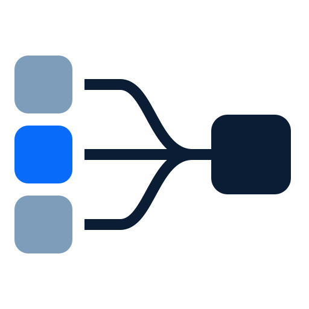

<p>
  
</p>

# Subregator Frontend

**Find and compare IPv4 lease and purchase offers in one place.**

[Website](https://subregator.com) · [Backend](https://github.com/subregator/subregator-backend) · [Development guide](docs/guide.md) · [Report an issue](https://github.com/subregator/subregator-frontend/issues)

The web interface for Subregator: a searchable provider catalogue with clear pricing, listing history and source-backed network observations. Built with HTML, CSS and vanilla JavaScript, with a small Python server. No frontend build step is required.

## What you can do

- Compare offers by provider, RIR, prefix size, currency and price per IP.
- Review billing terms, fees, availability and links to the original provider.
- Explore observed price history and BGP, RPKI and Spamhaus DROP checks.
- Share filtered views by URL and browse on desktop or mobile.

Unknown fees and missing observations stay explicit. Network checks describe their sources, not a guarantee that a prefix is safe or reachable.

## Quick start

Requires **Python 3.11+**. From the repository root:

```sh
python3 serve.py
```

Open [localhost:5173](http://localhost:5173). The server proxies requests to the public Subregator API by default; you do not need to run the backend locally.

### Use a local backend

Start the [backend](https://github.com/subregator/subregator-backend), then point the frontend at it:

```sh
SUBREGATOR_API_URL=http://127.0.0.1:8080 python3 serve.py
```

Use the Python server rather than opening `index.html` directly: it serves the public assets and keeps API requests on the same origin.

## Development

Use **Node.js 24**, as in CI, for tests and formatting:

```sh
npm ci
npm test
npm exec playwright install chromium
npm run test:e2e
```

Before opening a PR, check formatting with `npm run format:check`. The [development guide](docs/guide.md) covers phone testing, data semantics and container deployment. The earlier Svelte application is archived in [legacy-svelte/](legacy-svelte/README.md).

## Contributing

Bug reports and pull requests are welcome. For UI changes, include desktop and mobile screenshots, keep keyboard navigation working, and run the relevant checks. Report data or collector issues in the [backend repository](https://github.com/subregator/subregator-backend/issues).

## License

[MIT](LICENSE). Third-party components retain their own licenses and copyright notices.
